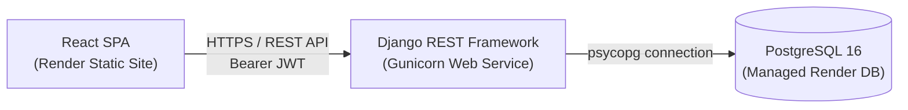

# Habit Tracker

[](https://github.com/vikapl23/habit_tracker/actions/workflows/ci.yml)

A full-stack, mobile-first habit tracking application with streak monitoring, habit lifecycle management, JWT authentication, and automated streak calculations.

---

## 📸 Screenshots

| Today View & Check-Ins | Create / Edit Habit | Habit Details & History |
|:---:|:---:|:---:|
|  |  |  |

*(Screenshots can be stored in [`docs/screenshots/`](docs/screenshots/).)*

---

## 🌐 Live Demo & Links

- **Frontend Application (Live):** [https://habit-tracker-frontend-32g6.onrender.com](https://habit-tracker-frontend-32g6.onrender.com)
- **Backend API Base:** [https://habit-tracker-backend-78p0.onrender.com/api/v1/](https://habit-tracker-backend-78p0.onrender.com/api/v1/)
- **Interactive Swagger Docs (Production):** [https://habit-tracker-backend-78p0.onrender.com/docs/](https://habit-tracker-backend-78p0.onrender.com/docs/)
- **Health Check Endpoint:** [https://habit-tracker-backend-78p0.onrender.com/health/](https://habit-tracker-backend-78p0.onrender.com/health/)

> [!NOTE]
> Render free web services spin down after 15 minutes of inactivity. Initial request wakeup takes ~30–50 seconds.

---

## ✨ Features

- **Habit Lifecycle**: Create, view, update, soft-archive, and restore habits with custom emojis and hex color validation.
- **Check-In Engine**: One-click idempotent check-ins for today or past dates with instant undo capability.
- **Streak Evaluation**: Real-time server-side computation of `current_streak` and lifetime `longest_streak`.
- **Target Frequency**: Flexible goal scheduling (daily or specific days of the week).
- **Check-In History**: Queryable log with optional date-range filtering (`?from=YYYY-MM-DD&to=YYYY-MM-DD`).
- **Secure Authentication**: JWT-based user isolation (`access` and `refresh` tokens) with IP rate limiting.
- **Interactive Documentation**: Interactive OpenAPI 3.0 / Swagger UI documentation (`/docs/`).
- **Responsive Mobile-First UI**: Tailwind CSS interface optimized for 375px mobile viewport and desktop.

---

## 🛠 Tech Stack

| Layer | Technologies |
|---|---|
| **Frontend** | React 19, TypeScript, Vite, Tailwind CSS, Lucide React |
| **Backend** | Python 3.12, Django 5.1, Django REST Framework (DRF) 3.15, Gunicorn |
| **Authentication** | `djangorestframework-simplejwt` (JWT access/refresh tokens) |
| **Database** | PostgreSQL 16 (Production / Docker), SQLite (Local Dev) |
| **Documentation** | OpenAPI 3.0 via `drf-spectacular`, Swagger UI |
| **Testing & Quality** | `pytest`, `pytest-django`, `freezegun`, `ruff`, Vitest, ESLint |
| **DevOps & CI/CD** | GitHub Actions, Docker, Docker Compose, Render Blueprint (`render.yaml`) |

---

## 🏗 Architecture Overview



- **Frontend**: Static React bundle served via Render CDN / Nginx with SPA routing rewrites.
- **API Backend**: Containerized Django service with automated migrations and static asset collection.
- **Database**: Managed PostgreSQL instance with foreign keys and unique constraints on `(habit, date)`.

---

## 🚀 Getting Started

### Prerequisites
- Python 3.12+
- Node.js 20+ and npm
- Docker Desktop (optional, for containerized run)

---

### Local Development

#### 1. Backend Setup

```powershell
# Clone repository
git clone https://github.com/vikapl23/habit_tracker.git
cd habit_tracker

# Create & activate virtual environment
python -m venv .venv
.\.venv\Scripts\Activate.ps1    # On Linux/macOS: source .venv/bin/activate

# Install backend dependencies
pip install -r requirements/local.txt

# Configure environment
copy .env.example .env          # On Linux/macOS: cp .env.example .env

# Apply migrations and run server
python manage.py migrate
python manage.py runserver
```

Backend will be available at [http://127.0.0.1:8000/api/v1/](http://127.0.0.1:8000/api/v1/) and Swagger UI at [http://127.0.0.1:8000/docs/](http://127.0.0.1:8000/docs/).

#### 2. Frontend Setup

In a separate terminal:

```powershell
cd frontend
copy .env.example .env          # Points VITE_API_URL to http://localhost:8000/api/v1
npm install
npm run dev
```

Frontend will run at [http://localhost:5173](http://localhost:5173).

---

### Run with Docker Compose

Run the entire production-grade stack (PostgreSQL 16, Django Backend with Gunicorn, and React served via Nginx) with a single command:

```powershell
# Ensure SECRET_KEY is set in .env
copy .env.example .env

# Build and start all services
docker compose up --build
```

- **Frontend App:** [http://localhost:3000](http://localhost:3000)
- **Backend API:** [http://localhost:8000/api/v1/](http://localhost:8000/api/v1/)
- **Swagger UI:** [http://localhost:8000/docs/](http://localhost:8000/docs/)

To create a superuser in Docker:
```powershell
docker compose exec backend python manage.py createsuperuser
```

To stop containers:
```powershell
docker compose down
```

---

## 🧪 Running Tests

### Backend Tests & Linting

```powershell
# Run backend test suite
pytest

# Verbose test run
pytest -v

# Code quality and formatting checks
ruff check .
ruff format --check .
```

### Frontend Tests & Linting

```powershell
cd frontend
npm test
npm run lint
```

---

## 📡 API Overview

Base URL: `/api/v1/`

| Method | Endpoint | Description | Auth Required |
|---|---|---|:---:|
| `POST` | `/auth/register/` | Register new user account | No |
| `POST` | `/auth/token/` | Obtain JWT access & refresh tokens | No |
| `POST` | `/auth/token/refresh/` | Refresh expired access token | No |
| `GET` | `/habits/` | List user habits (`?include_archived=true`, `?date=YYYY-MM-DD`) | Yes |
| `POST` | `/habits/` | Create a new habit | Yes |
| `GET` | `/habits/{id}/` | Retrieve habit details with streaks | Yes |
| `PUT` / `PATCH`| `/habits/{id}/` | Update habit attributes | Yes |
| `DELETE` | `/habits/{id}/` | Delete habit | Yes |
| `POST` | `/habits/{id}/check/` | Check in for today or past date (`{"date": "YYYY-MM-DD"}`) | Yes |
| `POST` | `/habits/{id}/uncheck/`| Undo check-in for date | Yes |
| `GET` | `/habits/{id}/check-ins/`| Get check-in history (`?from=...&to=...`) | Yes |
| `POST` | `/habits/{id}/archive/`| Archive habit (hides from default list) | Yes |
| `POST` | `/habits/{id}/unarchive/`| Restore archived habit | Yes |

Interactive testing available at `/docs/` (click **Authorize** and input `Bearer <access_token>`).

---

## 📮 Postman Collection

A complete, ready-to-import Postman collection is included in [`postman/`](postman/):
- File: [`postman/habit_tracker.postman_collection.json`](postman/habit_tracker.postman_collection.json)
- Includes automated test scripts that save the JWT token into collection variables upon login and reuse it across all habit requests.

---

## 🔄 CI/CD Pipeline

Continuous Integration is automated using **GitHub Actions** ([`.github/workflows/ci.yml`](.github/workflows/ci.yml)):
- **Backend Job**: Ruff linting, code formatting check, and full `pytest` suite execution across Python 3.12.
- **Frontend Job**: ESLint code inspection, Vitest unit test suite, and production build check (`npm run build`).
- **Docker Smoke Check**: Builds production backend and frontend images to verify container compatibility before merge.

---

## ☁️ Deployment

The project is configured for one-click deployment via **Render Blueprint** ([`render.yaml`](render.yaml)):
1. **Database**: Managed PostgreSQL instance.
2. **Backend**: Web Service built with `Dockerfile`, running `scripts/entrypoint.sh` for non-interactive migrations, static collection, automatic superuser creation, and Gunicorn.
3. **Frontend**: Static Site built with Vite (`npm run build`) and SPA rewrite routing rules.

---

## 📋 Development Process

The project followed a structured engineering methodology documented in [`docs/`](docs/):

1. **Plan Mode First**: Detailed specification, streak calculation algorithms, and database schema designed in [`docs/PLAN.md`](docs/PLAN.md) before writing code.
2. **Test-Driven Development (TDD)**: Comprehensive unit and integration test coverage (`pytest`, `freezegun`, `pytest-django`) written alongside API endpoints.
3. **Architectural Decisions**: Key technical tradeoffs documented in [`docs/DECISIONS.md`](docs/DECISIONS.md).
4. **Iterative Code Reviews**: Milestones audited and documented in formal review reports:
   - [MVP Review](docs/REVIEW_MVP.md)
   - [Target Frequency Feature Review](docs/REVIEW_FREQUENCY.md)
   - [Frontend Review & Audit](docs/REVIEW_FRONTEND.md)
   - [Mentor Evaluation](docs/REVIEW_MENTOR.md)
