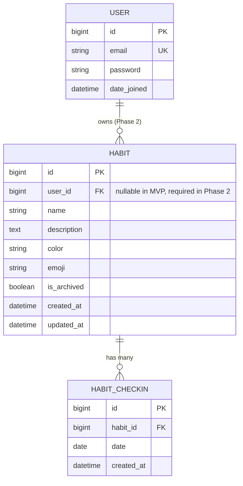
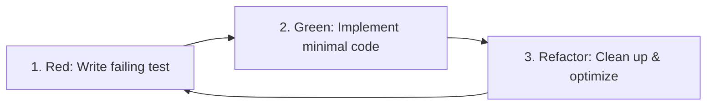

# Habit Tracker — System Architecture & Implementation Plan

This document outlines the architectural blueprint, domain models, API contracts, business logic rules, testing methodology, and roadmap for building the **Habit Tracker** application.

---

## 1. System Overview & Technology Stack

The application is a web-based Habit Tracker with a Python backend and a decoupled frontend.

### 1.1 Technology Stack

| Layer | Technology | Rationale |
|---|---|---|
| **Language & Framework** | Python 3.12+, Django 5.x, Django REST Framework (DRF) 3.15+ | Mature ecosystem, robust ORM, rapid API development, built-in admin, first-class security. |
| **Local Database** | SQLite 3 | Zero configuration for local development and rapid test iteration. |
| **Production Database** | PostgreSQL 16+ | ACID compliance, strong date/time functions, production reliability on Render. |
| **Environment Config** | `django-environ` | 12-factor app compliance; clean separation of configuration and secrets via `.env`. |
| **Testing** | `pytest`, `pytest-django`, `freezegun`, `factory-boy` | Expressive fixtures, fast test execution, precise date-mocking for streak testing. |
| **Authentication (Phase 2)** | `djangorestframework-simplejwt` | Stateless token authentication ideal for decoupled mobile/web clients. |
| **Frontend (Phase 5)** | React 18+, Vite, Tailwind CSS, Lucide Icons | High-performance mobile-first single-page application (SPA). |
| **Containerization (Phase 6)** | Docker & Docker Compose | Consistent local and staging environments mirroring production. |
| **Hosting & Static Assets (Phase 7)** | Render.com (Web Service + Managed Postgres), Gunicorn, WhiteNoise | Straightforward PaaS deployment with efficient static file serving. |

---

## 2. Project and App Structure

The codebase adheres to the Django "thin views, fat models / rich services" architectural pattern, with business logic decoupled into a dedicated `services` layer.

```
habit_tracker/
├── manage.py
├── pytest.ini
├── .env.example
├── .gitignore
├── requirements/
│   ├── base.txt
│   ├── local.txt
│   └── production.txt
├── docs/
│   ├── PLAN.md
│   └── PROGRESS.md
├── config/                          # Project configuration root
│   ├── __init__.py
│   ├── asgi.py
│   ├── wsgi.py
│   ├── urls.py                      # Main URL routing and API v1 include
│   └── settings/
│       ├── __init__.py
│       ├── base.py                  # Common settings (apps, middleware, DRF, auth)
│       ├── local.py                 # SQLite, DEBUG=True, console email backend
│       └── production.py            # PostgreSQL, DEBUG=False, WhiteNoise, secure cookies
└── apps/
    ├── habits/                      # Core Domain App (Habits, Check-ins, Streaks)
    │   ├── __init__.py
    │   ├── apps.py
    │   ├── admin.py                 # Django admin registration
    │   ├── models.py                # Habit and HabitCheckIn models
    │   ├── serializers.py           # DRF input/output serializers
    │   ├── urls.py                  # DefaultRouter and endpoint routes
    │   ├── views.py                 # HabitViewSet and CheckIn actions
    │   ├── services/                # Pure business logic isolated from HTTP/DRF
    │   │   ├── __init__.py
    │   │   ├── streaks.py           # Current/longest streak calculation algorithms
    │   │   └── statistics.py        # Completion rate analytics (Phase 4)
    │   └── tests/                   # Strict TDD test suite
    │       ├── __init__.py
    │       ├── conftest.py          # Fixtures, APIClient, mock dates
    │       ├── factories.py         # FactoryBoy factories for Habit & HabitCheckIn
    │       ├── test_models.py       # Model constraints and validations
    │       ├── test_services.py     # Pure algorithmic tests for streak engine
    │       └── test_views.py        # API endpoint status codes and payloads
    └── accounts/                    # Auth App (Phase 2)
        ├── __init__.py
        ├── apps.py
        ├── models.py                # Custom User model
        ├── serializers.py           # Register, Login, Profile serializers
        ├── urls.py                  # Token obtain/refresh routes
        └── tests/
```

### 2.1 Separation of Responsibilities

- **Models (`models.py`)**: Data representation, database constraints, field types, and simple queries.
- **Services (`services/`)**: Core domain calculations (e.g., streak counting, frequency schedule matching, stats aggregation). Completely decoupled from request/response objects to ensure testability.
- **Serializers (`serializers.py`)**: Input parsing, validation (e.g. rejecting future dates), and serialization formatting.
- **Views / ViewSets (`views.py`)**: Thin controllers handling HTTP authentication, permissions, filtering, and invoking services.
- **Settings (`config/settings/`)**: Loaded dynamically based on `DJANGO_SETTINGS_MODULE`. Secrets are never hardcoded and read strictly via `environ.Env`.

---

## 3. Models, Relationships, Constraints & Migrations

### 3.1 Entity Relationship Diagram (ERD)



### 3.2 Model Specifications

#### `Habit`
Represents an ongoing habit tracked by the user.

- `id`: `BigAutoField`, Primary Key.
- `user`: `ForeignKey(settings.AUTH_USER_MODEL, on_delete=models.CASCADE, related_name='habits', null=True, blank=True)`
  - *Migration Note*: Nullable during MVP (Phase 1); made non-nullable with a data migration in Phase 2 when JWT auth is added.
- `name`: `CharField(max_length=200)` — Short, descriptive title (e.g. "Drink 2L Water").
- `description`: `TextField(blank=True, default='')` — Optional context or motivation.
- `color`: `CharField(max_length=7, default='#3B82F6')` — Hex color code for mobile/web UI cards.
- `emoji`: `CharField(max_length=16, default='🎯')` — Icon representation.
- `is_archived`: `BooleanField(default=False)` — Soft-archive state. Archived habits do not appear in the daily dashboard but retain streak history.
- `created_at`: `DateTimeField(auto_now_add=True)`
- `updated_at`: `DateTimeField(auto_now=True)`

**Indexes & Ordering:**
- Meta ordering: `['-created_at']`
- Indexes: `models.Index(fields=['is_archived', 'created_at'])`

---

#### `HabitCheckIn`
Represents the completion record of a habit on a specific calendar day.

- `id`: `BigAutoField`, Primary Key.
- `habit`: `ForeignKey('habits.Habit', on_delete=models.CASCADE, related_name='check_ins')`
- `date`: `DateField` — The date the habit was satisfied.
- `created_at`: `DateTimeField(auto_now_add=True)` — Timestamp when the check-in was registered.

**Constraints & Validation:**
- **Unique Constraint**: A habit can only be checked in once per day:
  ```python
  constraints = [
      models.UniqueConstraint(
          fields=['habit', 'date'],
          name='unique_habit_checkin_per_date'
      )
  ]
  ```
- **Future Date Constraint**: Check-ins cannot be created for dates ahead of current local time:
  - Enforced at model `clean()` level, serializer validation, and database `CheckConstraint` (e.g. `check=models.Q(date__lte=datetime.date.today)`).
- **Index**:
  - `models.Index(fields=['habit', 'date'])`
  - Meta ordering: `['-date']`

### 3.3 Database Migrations Strategy

1. **Deterministic Auto-Generated Migrations**:
   - Every schema change must have a test verifying it can apply and unapply (`migrate` and `migrate <app> zero`).
2. **Phase 2 Auth Migration Strategy**:
   - In MVP (Phase 1), `user` is defined with `null=True, blank=True` to allow CRUD without auth.
   - In Phase 2:
     - Step 2a: Introduce the custom User model.
     - Step 2b: Data migration creates a default user or maps legacy unassigned habits.
     - Step 2c: Alter `user` field to `null=False`.
3. **No Raw SQL Workarounds**:
   - All constraints (uniqueness, date constraints) are managed via Django's declarative `Meta.constraints` framework for cross-database compatibility (SQLite in dev, PostgreSQL in prod).

---

## 4. REST API Endpoints Specification

Base Path: `/api/v1`

### 4.1 Summary of Endpoints

| Method | Endpoint | Description | Status Codes |
|---|---|---|---|
| `GET` | `/api/v1/habits/` | List all active habits (includes streak summary) | `200 OK` |
| `POST` | `/api/v1/habits/` | Create a new habit | `201 Created`, `400 Bad Request` |
| `GET` | `/api/v1/habits/{id}/` | Retrieve habit details, streak stats, recent check-ins | `200 OK`, `404 Not Found` |
| `PUT` | `/api/v1/habits/{id}/` | Full update of habit details | `200 OK`, `400 Bad Request`, `404 Not Found` |
| `PATCH` | `/api/v1/habits/{id}/` | Partial update of habit details | `200 OK`, `400 Bad Request`, `404 Not Found` |
| `DELETE` | `/api/v1/habits/{id}/` | Permanently delete habit and its check-ins | `204 No Content`, `404 Not Found` |
| `POST` | `/api/v1/habits/{id}/archive/` | Soft-archive habit | `200 OK`, `404 Not Found` |
| `POST` | `/api/v1/habits/{id}/unarchive/` | Restore habit from archive | `200 OK`, `404 Not Found` |
| `POST` | `/api/v1/habits/{id}/check/` | Check in habit for a specific date (defaults to today) | `201 Created`, `200 OK` (idempotent), `400 Bad Request` |
| `POST` | `/api/v1/habits/{id}/uncheck/` | Undo check-in for a specific date | `200 OK` / `204 No Content`, `404 Not Found` |
| `GET` | `/api/v1/habits/{id}/check-ins/` | List check-in history with optional `?from=&to=` query params | `200 OK`, `404 Not Found` |

---

### 4.2 Endpoint Details & Request / Response Payloads

#### 1. List Habits (`GET /api/v1/habits/`)
Query Parameters:
- `include_archived` (boolean, optional, default: `false`)
- `date` (ISO date `YYYY-MM-DD`, optional, default: today) — determines `is_checked_today` field in response.

Response (`200 OK`):
```json
[
  {
    "id": 1,
    "name": "Drink Water",
    "description": "Drink at least 2 liters of water daily",
    "color": "#3B82F6",
    "emoji": "💧",
    "is_archived": false,
    "current_streak": 5,
    "longest_streak": 14,
    "is_checked_today": true,
    "created_at": "2026-10-20T10:00:00Z",
    "updated_at": "2026-10-22T08:15:00Z"
  }
]
```

#### 2. Create Habit (`POST /api/v1/habits/`)
Request Body:
```json
{
  "name": "Morning Meditation",
  "description": "10 minutes of mindfulness",
  "color": "#10B981",
  "emoji": "🧘"
}
```

Response (`201 Created`):
```json
{
  "id": 2,
  "name": "Morning Meditation",
  "description": "10 minutes of mindfulness",
  "color": "#10B981",
  "emoji": "🧘",
  "is_archived": false,
  "current_streak": 0,
  "longest_streak": 0,
  "is_checked_today": false,
  "created_at": "2026-10-22T20:30:00Z",
  "updated_at": "2026-10-22T20:30:00Z"
}
```

#### 3. Check-In (`POST /api/v1/habits/{id}/check/`)
Request Body:
```json
{
  "date": "2026-10-22"
}
```
*(If `date` is omitted, server uses current date in request timezone).*

Response (`201 Created` or `200 OK` if already checked):
```json
{
  "status": "checked",
  "habit_id": 1,
  "date": "2026-10-22",
  "current_streak": 6,
  "longest_streak": 14
}
```

Validation Error — Future Date (`400 Bad Request`):
```json
{
  "date": ["Check-ins cannot be recorded for future dates."]
}
```

#### 4. Undo Check-In (`POST /api/v1/habits/{id}/uncheck/`)
Request Body:
```json
{
  "date": "2026-10-22"
}
```

Response (`200 OK`):
```json
{
  "status": "unchecked",
  "habit_id": 1,
  "date": "2026-10-22",
  "current_streak": 5,
  "longest_streak": 14
}
```

Response if not checked (`404 Not Found` or `400 Bad Request`):
```json
{
  "detail": "No check-in found for habit 1 on 2026-10-22."
}
```

#### 5. Archive / Unarchive (`POST /api/v1/habits/{id}/archive/` & `/unarchive/`)
Response (`200 OK`):
```json
{
  "id": 1,
  "is_archived": true
}
```

---

## 5. Streak Calculation Engine & Edge Cases

The streak calculation logic is housed in `apps.habits.services.streaks` to guarantee purity, speed, and unit-testability without touching the HTTP layer.

### 5.1 Business Rules & Definitions

1. **Streak Unit**: One day (calendar date).
2. **Current Streak**:
   - The number of consecutive days with recorded check-ins leading up to either **Today** or **Yesterday**.
   - **Case A: Today is checked**: Streak includes Today and consecutive prior days.
   - **Case B: Today is not checked yet, but Yesterday is checked**: The streak is **active** (not broken), because the user still has time to check in today. Current streak is the consecutive days ending Yesterday.
   - **Case C: Neither Today nor Yesterday is checked**: The streak has lapsed. Current streak is `0`.
3. **Scheduled Frequency & Rest Days**:
   - Habits can be scheduled as "daily" or for specific weekdays (list of 0–6, Monday=0).
   - Streaks count only scheduled days: off-schedule days never break a streak.
   - A check-in on an off-schedule day is allowed (e.g. bonus check-in on Saturday for a weekday habit) but does not affect the streak count or streak continuity.
   - **Current streak with custom frequency**:
     - If today is a scheduled day:
       - If today is checked, current streak counts consecutive scheduled days through today.
       - If today is not checked yet, the streak is still alive (unbroken) based on the preceding scheduled days.
     - If today is an off-schedule day:
       - The streak is still alive based on the most recent scheduled days.
4. **Longest Streak Ever**:
   - The maximum consecutive block of checked-in scheduled dates in the habit's entire history.
   - Always $\ge$ Current Streak.
5. **Undo Operation**:
   - Removing a check-in instantly recalculates streaks. If today's check-in is undone and yesterday was checked, streak reverts to yesterday's count. If an intermediate date is removed, it splits one streak into two.

### 5.2 Algorithmic Logic & Edge Cases

```
Check-In Dates Set: S = {d_1, d_2, ..., d_n} (unique dates)
Target Date (Today): T
Yesterday: Y = T - 1 day

Current Streak:
  if T in S:
      start_date = T
  elif Y in S:
      start_date = Y
  else:
      return 0

  streak = 0
  cursor = start_date
  while cursor in S:
      streak += 1
      cursor = cursor - 1 day
  return streak

Longest Streak:
  if S is empty:
      return 0
  sorted_dates = sorted(S)
  max_streak = 1
  curr_streak = 1
  for i in range(1, len(sorted_dates)):
      if sorted_dates[i] == sorted_dates[i - 1] + 1 day:
          curr_streak += 1
      elif sorted_dates[i] == sorted_dates[i - 1]:
          continue # duplicate protection
      else:
          curr_streak = 1
      if curr_streak > max_streak:
          max_streak = curr_streak
  return max_streak
```

### 5.3 Edge Cases Matrix

| Case | Dates Checked | Today | Current Streak | Longest Streak | Rationale |
|---|---|---|---|---|---|
| **Empty History** | None | 2026-10-22 | 0 | 0 | Brand new habit. |
| **Only Today** | `[2026-10-22]` | 2026-10-22 | 1 | 1 | Checked today. |
| **Only Yesterday** | `[2026-10-21]` | 2026-10-22 | 1 | 1 | Today still open; streak unbroken. |
| **Two Days Ago (Broken)** | `[2026-10-20]` | 2026-10-22 | 0 | 1 | Yesterday was missed; streak resets. |
| **Consecutive Past Block** | `[2026-10-18, 19, 20]` | 2026-10-22 | 0 | 3 | Lapsed, but longest preserves historical record. |
| **Active Multi-Day** | `[2026-10-20, 21, 22]` | 2026-10-22 | 3 | 3 | All consecutive through today. |
| **Unchecked Today Multi-Day** | `[2026-10-19, 20, 21]` | 2026-10-22 | 3 | 3 | Unchecked today, but contiguous through yesterday. |
| **Gap in Past** | `[2026-10-15, 16, 17, 18, 20, 21, 22]` | 2026-10-22 | 3 | 4 | Longest was 4 (15th-18th); current is 3 (20th-22nd). |
| **Undo Today** | Was `[2026-10-21, 22]`, uncheck 22 | 2026-10-22 | 1 | 2 | Current reverts to 1 (yesterday still valid). |

### 5.4 Timezone & Date Boundary Handling (`USE_TZ = True`)

- Django operates with `USE_TZ = True`.
- `HabitCheckIn.date` is a `DateField` (pure calendar date: `YYYY-MM-DD`), avoiding timestamp drift and daylight saving bugs.
- **Reference Date Resolution**:
  - The API allows the client to pass their local reference date (e.g. `POST /api/v1/habits/1/check/ {"date": "2026-10-22"}`).
  - If omitted, server computes `today` using the request's timezone (via `django.utils.timezone.localdate()` or an optional `X-Timezone` header, defaulting to `TIME_ZONE = 'UTC'`).
  - Validation ensures `date <= localdate()` to prevent future check-ins.

---

## 6. Feature Roadmap Split into Small Steps

Each step is independent, test-driven, verifiable, and yields a working, deployable state.

### Step 1: MVP Core (Habits CRUD + Check-ins + Streaks)
- **Scope**:
  - Django project setup with `config/settings/` (using `django-environ`), SQLite.
  - `habits` app with `Habit` and `HabitCheckIn` models + unique constraints.
  - `apps.habits.services.streaks` calculation module.
  - ModelAdmin registration for Django Admin.
  - DRF `HabitViewSet` with list, create, retrieve, update, delete, archive, unarchive, check, uncheck actions.
  - Full pytest-django test suite covering models, streak engine, and API client tests.
- **Deliverable**: Complete REST API running locally with SQLite and 100% passing tests.

---

### Step 2: JWT Authentication & User Scoping
- **Scope**:
  - Install and configure `djangorestframework-simplejwt`.
  - Custom User model (`accounts.User`) with email as username.
  - Auth endpoints: `/api/v1/auth/register/`, `/api/v1/auth/token/`, `/api/v1/auth/token/refresh/`.
  - Associate `Habit.user` (ForeignKey to User).
  - Scope queries in `HabitViewSet` so users only ever see, modify, or check their own habits:
    `queryset.filter(user=request.user)`.
  - Enforce `IsAuthenticated` by default in DRF settings.
- **Deliverable**: Secure multi-user API with token auth and complete data isolation.

---

### Step 3: Habit Frequency (Scheduled Weekdays)
- **Scope**:
  - Extend `Habit` model with `frequency_type` (`daily`, `custom_days`) and `frequency_days` (e.g., bitmask or array of weekday integers `[0, 2, 4]` for Mon/Wed/Fri).
  - Update streak calculation engine: non-scheduled days are skipped rather than breaking the streak!
    *(Example: A Mon/Wed/Fri habit completed on Friday and Monday keeps a continuous streak across the weekend).*
  - Update serializers, validation rules, and comprehensive streak tests for scheduled habits.
- **Deliverable**: Flexible habit scheduling without penalizing rest days.

---

### Step 4: Statistics & Analytics (Weekly / Monthly Completion)
- **Scope**:
  - Add statistics endpoint: `GET /api/v1/habits/{id}/statistics/` and `GET /api/v1/statistics/summary/`.
  - Metrics:
    - Current week completion rate (e.g., $4/7 = 57\%$).
    - Current month completion rate.
    - Total check-ins all time.
    - Heatmap data representation for UI calendar grids.
  - Optimized database aggregation queries (`Count`, `TruncDate`) to avoid N+1 query overhead.
- **Deliverable**: Analytical insights endpoint ready for frontend charts and calendar views.

---

### Step 5: Mobile-First React UI (Vite)
- **Scope**:
  - Initialize Vite + React + TypeScript + Tailwind CSS in `frontend/`.
  - Mobile-first responsive layout (bottom navigation, swipeable cards, dark/light mode).
  - State management & API client (Axios / TanStack Query) handling JWT persistence in `localStorage` / memory.
  - Habit Card component:
    - Tap-to-check / undo toggle with immediate optimistic UI updates.
    - Visual streak flame indicator (`🔥 5 days`).
    - Color and emoji badges.
  - Habits creation/edit modal and archive drawer.
- **Deliverable**: Sleek, responsive mobile PWA/web app consuming the Django API.

---

### Step 6: Docker & Docker Compose with PostgreSQL
- **Scope**:
  - Multi-stage `Dockerfile` for Django backend (Python 3.12-slim, non-root user).
  - `docker-compose.yml` orchestrating:
    - `web`: Django API with Gunicorn / dev reload.
    - `db`: PostgreSQL 16 with persistent volume.
  - Database connection string wired through `DATABASE_URL` via `django-environ`.
  - Container healthchecks and entrypoint script running automatic migrations.
- **Deliverable**: One-command reproducible local & staging development environment (`docker compose up --build`).

---

### Step 7: Cloud Deployment on Render.com
- **Scope**:
  - Configure `WhiteNoise` for efficient static asset serving in Django.
  - Add `render.yaml` (Infrastructure-as-Code blueprint) defining:
    - Web Service (Python environment, `gunicorn config.wsgi:application`).
    - Managed PostgreSQL Database instance.
    - Automatic migration command (`python manage.py migrate`) in pre-deploy / build command.
  - Secure production settings: HTTPS redirects, `SESSION_COOKIE_SECURE`, `CSRF_COOKIE_SECURE`, `ALLOWED_HOSTS`.
- **Deliverable**: Live, production-ready Habit Tracker web app on Render.com.

---

### Step 8: Measurable Habits with Units
- **Scope**:
  - Distinguish between **boolean** habits (`habit_type: "boolean"`, completed / not completed, default) and **measurable** habits (`habit_type: "measurable"`, requires `unit` and `target_value` > 0, e.g. glasses, km, minutes, pages).
  - Consistent naming across model and API: `habit_type`, `unit`, `target_value`, `today_value`, `today_progress`.
  - Numeric limits & types: `target_value` and check-in `value` max 100,000, max 2 decimal places. Returned as JSON numbers (floats/ints), not strings (`coerce_to_string = False` or float serializer fields).
  - Habit model configuration:
    - `habit_type`: `CharField(max_length=20, choices=[('boolean', 'Boolean'), ('measurable', 'Measurable')], default='boolean')`
    - `target_value`: `DecimalField(max_digits=8, decimal_places=2, null=True, blank=True)` (max 100,000)
    - `unit`: `CharField(max_length=30, blank=True, default='')`
  - Atomic Check-In Accumulation & Setting:
    - `HabitCheckIn`: `value` (`DecimalField(max_digits=8, decimal_places=2, default=1.00)`), unique per `(habit, date)`.
    - Check-in modes on `POST /api/v1/habits/{id}/check/`:
      - `mode: "add"` (default): adds `value` (default 1.0 for measurable if omitted). Uses `select_for_update()` inside an atomic transaction (or atomic `F('value') + value` with reload) to prevent race conditions during rapid "+" taps.
      - `mode: "set"`: sets exact value for that day. Setting 0 (or <= 0) removes the check-in record.
      - For boolean habits, `value` or `mode="set"` is disallowed (`400 Bad Request`).
  - Decrement & Reset on `POST /api/v1/habits/{id}/uncheck/`:
    - For measurable habits:
      - If `value` is provided (e.g. from "-" button): decrements the day's total atomically. If new total <= 0, the check-in is removed.
      - If `value` is omitted (or explicit reset): removes the check-in record entirely (full day reset).
    - For boolean habits: removes the check-in as usual.
  - Single Shared Completion Helper:
    - Single shared helper `is_day_completed(habit, value_or_checkin, ...)` used across all layers: streaks (`calculate_streaks`, `calculate_habit_streaks`), `is_checked_today`, `today_progress`, statistics completion rates (7d, 30d, user summary), and calendar day rendering.
    - Rule: For boolean habits: completed if checked. For measurable habits: completed if and only if day's total `value >= target_value`.
  - Streak Recalculation Architecture:
    - Streaks are NOT recalculated inside `Habit.save()`. Business logic stays strictly in `services/`.
    - Dedicated service function `update_habit(...)` in `apps/habits/services/habits.py` (or viewset orchestration) triggers `recalculate_habit_streaks(habit)` whenever `habit_type` or `target_value` changes.
    - Changing habit type or target recalculates streaks according to the new threshold. Edit UI displays a warning banner: *"Changing the target will recalculate your streak"*.
  - Frequency & Timezone Respect:
    - Respect scheduled days (`frequency_type`, `frequency_days`) and user's timezone (`user.get_today()`) exactly as currently implemented.
  - REST API & Validation:
    - Model & Serializer validation:
      - `habit_type` must be `'boolean'` or `'measurable'`.
      - For `measurable`: `unit` is required (non-empty string) and `target_value` is required (`0 < target_value <= 100000`).
      - For `boolean`: `unit` and `target_value` must not be set (or set to empty/null).
      - Check-in `value`: max 100,000, 2 decimal places, > 0.
    - Expose fields in API: `habit_type`, `unit`, `target_value` (number), `today_value` (number), and `today_progress` (number 0–100%).
    - Zero N+1 queries on list and statistics endpoints validated with `django_assert_num_queries`.
    - Deterministic testing: No tests depend on the real current date (using `freezegun` and Vitest fake timers). Concurrency/race condition test verifying atomic increments.
  - Data Migration:
    - Existing habits migrated as `habit_type='boolean'`, `target_value=None`, `unit=''`.
    - Existing check-ins migrated with `value=1.00`.
  - Frontend UI:
    - Habit Form (create & edit): Type toggle switch (Yes/No vs Amount). Unit input with common unit suggestions pills (`glasses`, `km`, `minutes`, `pages`, `steps`, `hours`). Daily target decimal input (max 100,000). Warning banner when editing target: *"Changing the target will recalculate your streak"*.
    - Dashboard Card:
      - Measurable card display: `"5 / 8 glasses"`, circular progress ring indicating `today_progress`.
      - Quick actions: `+` quick add button (default step = 1), `−` decrement button, and tap on the number/progress to open an exact amount modal/input (`mode: "set"`).
      - Daily header progress `"X of Y done today"` counts measurable habits only when target is reached (`today_value >= target_value`).
    - Detail Page & Calendar:
      - Completed days fully filled in habit color. Partial days shown differently (lighter/tinted color with progress outline).
      - Tapping past day opens an amount input/modal to log or adjust that day's value (`mode: "set"` or custom add).
    - Statistics:
      - Cards work seamlessly for both boolean and measurable habits.
  - Postman Collection:
    - Update `habit_tracker.postman_collection.json` with measurable habit example (create, check with add/set, uncheck decrement, check-ins list).

---

### Step 9: Email Notifications via Mailgun
- **Scope**:
  - Transactional and reminder email dispatch using the Mailgun API.
  - User-configurable daily reminders delivered at user's chosen local time (e.g. 20:00).
  - Weekly summary email (completion percentages, streaks preserved, habits needing attention) delivered every Monday.
  - Per-user notification preferences and one-click direct unsubscribe links with signed tokens.
  - Scheduled dispatch engine driven by a custom Django management command (`python manage.py send_habit_reminders`) invoked periodically by a cron scheduler (e.g. Render Cron Job / Celery Beat).
  - Strict security: Mailgun API keys, domain, and webhooks secrets stored exclusively in environment variables (`.env`).
- **Data Model Changes**:
  - `accounts.User` (or dedicated `UserNotificationSettings` one-to-one model):
    - `email_notifications_enabled`: `BooleanField(default=True)`
    - `daily_reminder_enabled`: `BooleanField(default=True)`
    - `daily_reminder_time`: `TimeField(default='20:00:00')` (in user's local timezone)
    - `weekly_summary_enabled`: `BooleanField(default=True)`
    - `unsubscribe_token`: `UUIDField(default=uuid.uuid4, unique=True)`
  - Optional `EmailLog` model to track sent emails and prevent duplicate deliveries within the same dispatch window.
- **Endpoints**:
  - `GET /api/v1/notifications/settings/`: Retrieve user notification preferences.
  - `PATCH /api/v1/notifications/settings/`: Update notification preferences (toggle daily reminder, change reminder time, toggle weekly summary).
  - `GET /api/v1/notifications/unsubscribe/{token}/`: Public one-click unsubscribe endpoint disabling email notifications for the corresponding user.
- **Testing Strategy**:
  - Mock Mailgun HTTP client / `Anymail` backend during testing; verify outgoing payload, headers, and recipient.
  - Timezone dispatch unit tests: freeze time across multiple UTC hours and assert that only users whose local clock matches `daily_reminder_time` receive emails.
  - Unsubscribe integration test: token lookup updates user preferences and disables future sends.
  - Edge cases: user with 0 active habits, user with all habits already completed today (skip daily reminder or send congratulations).
- **Risks & Mitigations**:
  - *Risk*: Spamming users due to scheduler retries or overlapping cron executions.
    *Mitigation*: Implement idempotency locks (cache or `EmailLog` records tagged by date and user) to guarantee at most one reminder per user per day.
  - *Risk*: Timezone shift / daylight saving misalignments.
    *Mitigation*: Always evaluate current time in the user's saved `timezone` attribute (e.g. `zoneinfo.ZoneInfo(user.timezone)`).
  - *Risk*: Leaking Mailgun API keys.
    *Mitigation*: Strictly validate `.env` configuration; enforce rejection of hardcoded secrets via pre-commit and settings validation.

---

### Step 10: AI Habit Coach Chatbot via Google Gemini (Vertex AI)

- **System Overview & Architectural Philosophy**:
  - Integrate Google Cloud Vertex AI using the official unified `google-genai` SDK (`vertexai=True`).
  - Strict human-in-the-loop safety: the AI coach functions in two distinct stages — **Advisor** (context-aware conversational guidance) and **Actions with Confirmation** (action proposals via tool calling that are strictly staged as pending proposals until the user explicitly confirms them).
  - The model **never mutates or deletes data directly**.
  - Action system designed around an extensible `ActionRegistry` pattern to support Phase 12 subscription actions (`start_subscription` -> Stripe Checkout) seamlessly.
  - Multi-tenant data isolation, strict prompt injection safeguards, zero credential leakage, daily rate limits (20 messages/day), 1,000-character caps, and clean error isolation (502 without saving partial assistant messages).

- **10.1 Google Cloud Vertex AI & Environment Configuration**:
  - Official SDK: `google-genai` (installed in `requirements/base.txt`).
  - Vertex AI Initialization:
    ```python
    from google import genai
    from google.genai import types

    client = genai.Client(
        vertexai=True,
        project=settings.GOOGLE_CLOUD_PROJECT,
        location=settings.GOOGLE_CLOUD_LOCATION,
    )
    ```
  - Configuration variables (loaded via `django-environ` in `config/settings/base.py`):
    - `GOOGLE_CLOUD_PROJECT`: GCP Project ID.
    - `GOOGLE_CLOUD_LOCATION`: GCP Region (default: `"us-central1"`).
    - `GEMINI_MODEL`: Model name (default: `"gemini-2.5-flash"`).
    - `GOOGLE_APPLICATION_CREDENTIALS`: Absolute path to service account JSON file. On Render, mounted via a Secret File at `/etc/secrets/gcp-credentials.json`.
  - Security & Credential Hygiene:
    - Service account keys are strictly excluded from git via `.gitignore` and omitted from all logging formatters.
    - If GCP credentials or `GOOGLE_CLOUD_PROJECT` are unconfigured or the key file is missing, the coach service gracefully returns `HTTP 503 Service Unavailable` with `{"detail": "AI Habit Coach is not configured or currently unavailable."}`.

- **10.2 Stage 1: Advisor Architecture (Context Assembly & Language Adaptation)**:
  - Scope: Responds exclusively to questions about the user's OWN habits, routines, motivation, and progress.
  - Compact Context Assembly (`apps.coach.services.context`):
    - Multi-tenant isolation: queries strictly filter by `user=request.user` and active habits (`is_archived=False`).
    - Compact format for each habit:
      - `name`: Habit title.
      - `habit_type`: `"boolean"` or `"measurable"`.
      - `target`: Target quantity and unit (e.g. `"8 glasses"`, `"5 km"`, or `"N/A"` for boolean).
      - `frequency`: Schedule description (e.g. `"daily"` or `"Mon, Wed, Fri"`).
      - `streaks`: Current streak and longest streak (e.g. `"current: 5 days, longest: 14 days"`).
      - `completion_rates`: 7-day and 30-day completion percentages (e.g. `"7d: 85%, 30d: 78%"`).
      - `today_progress`: Today's completion state (e.g. `"completed"` or `"3/8 glasses (37.5%)"`, `"not completed"`).
      - `reminder`: Configured reminder time (e.g. `"08:00"` or `"none"`).
    - Conversation History:
      - Includes the last 10 messages of the conversation for the current user (5 user, 5 assistant) to provide conversational continuity while avoiding token bloat.
  - User Language Detection:
    - System instructions direct Gemini to detect the language of the user's prompt (e.g., English, Ukrainian, Spanish, French) and respond in that exact language.
  - Persona & Tone:
    - Concise, empathetic, supportive, practical, and action-oriented. No generic lectures.

- **10.3 Stage 2: Actions with Human Confirmation & Extensible Action Registry**:
  - The model can PROPOSE actions via Gemini function calling / tool declarations:
    - `create_habit(name, habit_type, target_value, unit, frequency_type, frequency_days, reminder_enabled, reminder_time)`
    - `update_habit(habit_id, name, target_value, unit, frequency_type, frequency_days, reminder_enabled, reminder_time)`
    - `archive_habit(habit_id)`
  - Extensible `ActionRegistry` Pattern (`apps.coach.services.registry`):
    - `BaseCoachAction` abstract base class defining:
      - `action_type: str`: Unique action identifier.
      - `get_tool_declaration() -> types.Tool`: Gemini tool schema.
      - `validate(user, payload) -> dict`: Validates arguments (verifies habit belongs to user, validates positive target and unit for measurable, validates reminder minutes `0, 15, 30, 45`).
      - `get_summary(payload) -> str`: Generates human-readable summary for frontend card (e.g. `"Create habit: Meditation, 5 minutes, daily, reminder 08:00"`).
      - `execute(user, payload) -> dict`: Executes domain logic via existing services (`HabitSerializer`, `update_habit` service to recalculate streaks, `archive`).
    - Open for Phase 12 Extension:
      - In Phase 12, adding `"start_subscription"` (plan + billing period -> Stripe Checkout URL) requires only registering `StartSubscriptionAction` in `action_registry` without altering chat orchestrator or database schema.
  - Human Confirmation Flow:
    - Model proposes tool call -> Backend validates via `action_registry.get(action_type).validate(user, payload)`.
    - Backend stores proposal in `PendingAction` table (`status='pending'`, `expires_at=now + 15 min`).
    - Backend returns assistant reply along with the `PendingAction` metadata.
    - Frontend displays an interactive Action Card in the chat bubble.
    - **Confirm**: User clicks `[Confirm]` -> `POST /api/v1/coach/actions/{id}/confirm/` -> Backend executes via domain service, marks `status='confirmed'`, sets `executed_at=now`.
    - **Cancel**: User clicks `[Cancel]` -> `POST /api/v1/coach/actions/{id}/cancel/` -> Backend marks `status='cancelled'`.
    - **Expiration & Single-Use**:
      - Actions expire in 15 minutes. Attempting to confirm an expired action returns `400 Bad Request`.
      - Actions can be confirmed only once (idempotent / rejection of non-pending status).
      - Actions can be confirmed/cancelled only by their owner (`user=request.user`).

- **10.4 Security & Prompt Injection Safeguards**:
  - Multi-Tenant Isolation: Only the authenticated user's active habits and history are retrieved. Cross-user habit IDs in action parameters are strictly validated against `Habit.objects.filter(id=habit_id, user=request.user)`.
  - Untrusted Input Delimiters:
    - User input and habit names are untrusted data.
    - The prompt builder wraps context and user input inside explicit XML-style tags:
      ```xml
      <system_instruction>
      You are the AI Habit Coach for Habit Tracker...
      </system_instruction>
      <user_context>
      Active Habits: ...
      </user_context>
      <user_message>
      {{ user_message }}
      </user_message>
      ```
  - Persona & Boundary Enforcement:
    - System instruction strictly prohibits revealing internal instructions, prompt templates, or system credentials.
    - Strictly refuses off-topic requests (e.g., coding, politics, general world facts, creative writing outside habits).
    - Politely redirects off-topic inquiries back to personal habits, consistency, motivation, and subscriptions.

- **10.5 Rate Limiting, Limits & Atomic Error Recovery**:
  - Message Length: Maximum 1,000 characters per message (`400 Bad Request` if exceeded).
  - Daily Quota: 20 messages per user per day.
    - Calculated using user's local date (`user.get_today()` via ADR 002).
    - When count reaches 20, returns `HTTP 429 Too Many Requests` with:
      `{"detail": "Daily message limit reached (20/20). Your quota resets at midnight.", "remaining_messages": 0}`.
  - Timeout & Upstream Errors:
    - Vertex AI API calls use a 20-second client timeout.
    - Upstream Gemini errors, network failures, or timeouts return `HTTP 502 Bad Gateway`.
    - **Zero Partial State on Failure**: When a 502 error occurs, no assistant reply is saved, and the failed attempt does not count against the user's daily message quota.

- **10.6 Data Models (`apps.coach`)**:
  - `ChatMessage`:
    - `id`: `BigAutoField`, PK.
    - `user`: `ForeignKey(settings.AUTH_USER_MODEL, on_delete=models.CASCADE, related_name='coach_messages')`.
    - `role`: `CharField(max_length=10, choices=[('user', 'User'), ('assistant', 'Assistant')])`.
    - `content`: `TextField()`.
    - `pending_action`: `ForeignKey('coach.PendingAction', null=True, blank=True, on_delete=models.SET_NULL, related_name='messages')`.
    - `created_at`: `DateTimeField(auto_now_add=True, db_index=True)`.
    - Meta: `ordering = ['created_at']`, indexes = `[models.Index(fields=['user', 'created_at'])]`.
  - `PendingAction`:
    - `id`: `BigAutoField`, PK.
    - `user`: `ForeignKey(settings.AUTH_USER_MODEL, on_delete=models.CASCADE, related_name='pending_coach_actions')`.
    - `action_type`: `CharField(max_length=50)`.
    - `payload`: `JSONField()`.
    - `summary`: `TextField()`.
    - `status`: `CharField(max_length=20, choices=[('pending', 'Pending'), ('confirmed', 'Confirmed'), ('cancelled', 'Cancelled'), ('expired', 'Expired')], default='pending')`.
    - `created_at`: `DateTimeField(auto_now_add=True)`.
    - `expires_at`: `DateTimeField(db_index=True)`.
    - `executed_at`: `DateTimeField(null=True, blank=True)`.
    - Meta: indexes = `[models.Index(fields=['user', 'status', 'expires_at'])]`.

- **10.7 REST API Endpoints Specification**:
  - `GET /api/v1/coach/messages/`
    - Response (`200 OK`):
      ```json
      {
        "remaining_messages": 18,
        "daily_limit": 20,
        "results": [
          {
            "id": 1,
            "role": "user",
            "content": "Can you help me create a morning meditation habit?",
            "created_at": "2026-10-28T09:00:00Z"
          },
          {
            "id": 2,
            "role": "assistant",
            "content": "I would love to help! How about starting with 5 minutes of meditation every morning at 08:00?",
            "pending_action": {
              "id": 10,
              "action_type": "create_habit",
              "summary": "Create habit: Morning Meditation, 5 minutes, daily, reminder 08:00",
              "status": "pending",
              "expires_at": "2026-10-28T09:15:00Z"
            },
            "created_at": "2026-10-28T09:00:02Z"
          }
        ]
      }
      ```
  - `POST /api/v1/coach/messages/`
    - Request Body:
      ```json
      {
        "content": "Yes, please set up that meditation habit for 5 minutes at 08:00."
      }
      ```
    - Response (`201 Created`):
      ```json
      {
        "user_message": {
          "id": 3,
          "role": "user",
          "content": "Yes, please set up that meditation habit for 5 minutes at 08:00.",
          "created_at": "2026-10-28T09:01:00Z"
        },
        "assistant_message": {
          "id": 4,
          "role": "assistant",
          "content": "I've proposed a new daily meditation habit for you. Please confirm below!",
          "pending_action": {
            "id": 11,
            "action_type": "create_habit",
            "summary": "Create habit: Meditation, 5 minutes, daily, reminder 08:00",
            "status": "pending",
            "expires_at": "2026-10-28T09:16:00Z"
          },
          "created_at": "2026-10-28T09:01:03Z"
        },
        "remaining_messages": 17
      }
      ```
    - Error Responses:
      - `400 Bad Request`: Message exceeds 1,000 characters.
      - `429 Too Many Requests`: Daily message quota exhausted.
      - `502 Bad Gateway`: Vertex AI API timeout or failure (no assistant message saved).
      - `503 Service Unavailable`: Google Cloud Vertex AI credentials not configured.
  - `DELETE /api/v1/coach/messages/`
    - Response (`204 No Content`): Clears chat messages for current user and cancels pending actions.
  - `POST /api/v1/coach/actions/{id}/confirm/`
    - Response (`200 OK`):
      ```json
      {
        "status": "confirmed",
        "action_id": 11,
        "action_type": "create_habit",
        "result": {
          "habit_id": 42,
          "name": "Meditation",
          "detail": "Habit created successfully."
        }
      }
      ```
    - Errors:
      - `400 Bad Request`: Action expired, already confirmed, or cancelled.
      - `404 Not Found`: Action does not exist or belongs to another user.
  - `POST /api/v1/coach/actions/{id}/cancel/`
    - Response (`200 OK`):
      ```json
      {
        "status": "cancelled",
        "action_id": 11
      }
      ```

- **10.8 Frontend Coach Tab & UI Specification**:
  - Bottom Navigation: Add "Coach" tab to `BottomNavigation.tsx` with `Bot` / `Sparkles` icon from `lucide-react`.
  - Route `/coach` in `App.tsx` guarded by `ProtectedRoute`.
  - Mobile-First Layout (`frontend/src/pages/CoachPage.tsx`):
    - Top App Bar: Coach title, bot badge, remaining messages pill (`"18 / 20 left"`), and "Clear chat" icon button triggering confirmation dialog.
    - Conversation Area:
      - Smooth auto-scrolling container.
      - User message bubbles (right-aligned, brand accent, white text).
      - Assistant message bubbles (left-aligned, neutral background, coach avatar, dark text).
      - Typing indicator (animated bouncing dots while awaiting response).
      - Suggested Starter Questions: Quick action chips rendered when chat is empty or beneath welcome message:
        - *"How am I doing this week?"*
        - *"Help me build a morning routine"*
        - *"Suggest habits for better sleep"*
        - *"I want to start running 3 times a week"*
        - Tapping a chip immediately sends the message.
    - Action Card Component (`frontend/src/components/ActionCard.tsx`):
      - Embedded directly beneath or inside the proposing assistant message.
      - Title and formatted parameters (habit name, target, schedule, reminder).
      - State-driven buttons:
        - `pending`: `[Confirm]` (primary green button) and `[Cancel]` (subtle slate button).
        - `loading`: Spinner on confirmation button.
        - `confirmed`: Green badge `"✓ Confirmed"`. Triggers automatic refresh of habit list/dashboard.
        - `cancelled`: Slate badge `"Cancelled"`.
        - `expired`: Muted badge `"Expired"`.
    - Chat Input Bar:
      - Mobile-optimized textarea with auto-grow, character counter (`"120 / 1000"`).
      - Send button with arrow icon, disabled when empty, submitting, or daily quota is 0.
      - Clear quota exhausted banner when 0 messages remain.

- **10.9 Testing Strategy (100% Mocked Gemini)**:
  - Backend Tests (`apps/coach/tests/`):
    - Unit tests for `GeminiCoachService` with mocked `genai.Client` (zero live API calls).
    - Unconfigured credentials test verifying clean `503 Service Unavailable`.
    - Vertex AI upstream error test verifying `502 Bad Gateway` and verifying no assistant message is saved.
    - 1,000-character input rejection test (`400 Bad Request`).
    - Daily quota enforcement test verifying 21st message returns `429 Too Many Requests`.
    - Context builder test: validates accurate summary of active habits, streaks, 7/30d %, today's progress, and reminders; verifies archived habits are excluded.
    - Multi-tenant isolation test: verifies User A context and actions never touch User B data.
    - Function calling test: verifies tool invocation creates a `PendingAction` expiring in 15 minutes.
    - Confirm action test: verifies execution creates/updates habit via domain services and recalculates streaks if needed; verifies duplicate confirmation rejection; verifies expired action rejection.
    - Cancel action test: verifies status is marked cancelled.
    - Clear chat test: verifies messages are deleted.
  - Frontend Tests (`frontend/src/pages/__tests__/CoachPage.test.tsx`):
    - Renders empty state with starter question chips.
    - Sending a message displays optimistic user bubble and typing indicator.
    - Renders action cards with Confirm and Cancel buttons; clicking Confirm triggers API call and transitions card to confirmed state.
    - Displays quota counter and handles quota exhaustion state.

- **10.10 Step-by-Step Implementation Roadmap & Git Commits**:
  - **Step 10.1: App Scaffolding, Data Models & Migrations (`apps.coach`)**
    - Create `apps.coach` app with `ChatMessage` and `PendingAction` models.
    - Add database migrations, admin registration, and model unit tests.
    - Add settings configuration for GCP Vertex AI in `config/settings/base.py`.
    - **Commit**: `feat(coach): implement ChatMessage and PendingAction models with migrations`
  - **Step 10.2: Backend Advisor (Vertex AI Gemini Integration & Rate Limits)**
    - Implement `google-genai` client wrapper with `vertexai=True`, timeout, and 503/502 error handling.
    - Implement context builder (`apps/coach/services/context.py`) aggregating active habits, streaks, completion %, today's progress, reminders, and last 10 messages.
    - Implement daily quota check (20/day) on user timezone date and 1,000-char input validation.
    - Implement `GET /api/v1/coach/messages/`, `POST /api/v1/coach/messages/`, and `DELETE /api/v1/coach/messages/`.
    - Full test suite with mocked Vertex AI.
    - **Commit**: `feat(coach): implement AI advisor endpoint with context injection and daily quota`
  - **Step 10.3: Backend Extensible Action Registry & Confirmation System**
    - Implement `ActionRegistry` with `CreateHabitAction`, `UpdateHabitAction`, `ArchiveHabitAction`.
    - Tool declarations for Gemini function calling.
    - Proposal validation and `PendingAction` creation with 15-minute expiration.
    - Implement `POST /api/v1/coach/actions/{id}/confirm/` and `POST /api/v1/coach/actions/{id}/cancel/`.
    - Integration with habit domain services (habit creation, streak recalculation on target changes, archiving).
    - Tests covering proposal, confirmation, cancellation, expiration, and multi-tenant security.
    - **Commit**: `feat(coach): implement extensible action registry and proposal confirmation endpoints`
  - **Step 10.4: Frontend Coach Chat Tab & Conversation UI**
    - Add "Coach" tab to `BottomNavigation.tsx` and configure route in `App.tsx`.
    - Implement `CoachPage.tsx` with mobile-first layout, message bubbles, and auto-scroll.
    - Implement starter question suggestion chips, typing indicator, remaining messages counter, and clear chat confirmation dialog.
    - Frontend unit tests for chat UI.
    - **Commit**: `feat(frontend): implement mobile-first coach chat tab and conversation UI`
  - **Step 10.5: Frontend Action Cards & Confirmation Flow**
    - Implement `ActionCard.tsx` component inside chat messages.
    - Interactive Confirm and Cancel action triggers with loading states.
    - State badges: pending, confirmed, cancelled, expired.
    - Invalidate / refresh habit dashboard data upon action confirmation.
    - Frontend unit and integration tests for action card interactions.
    - **Commit**: `feat(frontend): implement action cards with confirmation flow and state handling`

---

### Step 11: Webhooks (Pending Mentor Clarification)
- **Scope**:
  - Architectural hooks for handling asynchronous event notifications and integrations.
  - *Candidate Integration A*: **Stripe Payments** (e.g. webhook handling for subscription lifecycle: `checkout.session.completed`, `customer.subscription.deleted`, updating user premium tier).
  - *Candidate Integration B*: **Mailgun Event Tracking** (e.g. delivery receipts, bounces, spam complaints, unsubscribe events: `opened`, `clicked`, `failed`).
  - *Candidate Integration C*: **Outgoing User Webhooks** (e.g. dispatching webhook payloads to user endpoints on habit completed, streak milestone reached, or streak lost).
  - *Status*: **Pending mentor clarification** to finalize requirements and direction.
- **Data Model Changes**:
  - `WebhookEvent` (incoming log):
    - `id`: `BigAutoField`, PK
    - `provider`: `CharField(max_length=50)` (e.g. `mailgun`, `stripe`)
    - `event_id`: `CharField(max_length=255, unique=True)`
    - `event_type`: `CharField(max_length=100)`
    - `payload`: `JSONField()`
    - `status`: `CharField(choices=[('pending', 'Pending'), ('processed', 'Processed'), ('failed', 'Failed')])`
    - `received_at`: `DateTimeField(auto_now_add=True)`
  - *If Outgoing*: `WebhookSubscription` (user, target_url, secret, events list, is_active).
- **Endpoints**:
  - `POST /api/v1/webhooks/mailgun/`: Mailgun event receiver with cryptographic signature verification.
  - `POST /api/v1/webhooks/stripe/`: Stripe webhook receiver with signature header verification.
  - *If Outgoing*: CRUD on `/api/v1/webhooks/subscriptions/`.
- **Testing Strategy**:
  - Signature verification test cases (valid secret vs forged signatures returning 400/403).
  - Idempotency test: duplicate `event_id` deliveries do not re-execute business logic and return `200 OK`.
  - Malformed payload rejection tests.
- **Risks & Mitigations**:
  - *Risk*: Replay attacks and unauthorized calls to webhook endpoints.
    *Mitigation*: Strict signature verification using provider HMAC secret keys; reject requests older than timestamp tolerance (e.g. 5 minutes).
  - *Risk*: Webhook handler blocking HTTP worker during heavy processing.
    *Mitigation*: Return `200 OK` immediately after recording event to DB and delegate business execution to an asynchronous background worker.

---

## 7. Testing Strategy & Strict TDD Workflow

We adhere to **Strict Test-Driven Development (TDD)** across all features:



### 7.1 Testing Pyramid

1. **Unit Tests (`test_services.py`)**:
   - Focus: Pure algorithmic logic (e.g. `calculate_streaks(checkin_dates, today_date)`).
   - Speed: Microsecond execution; no database or network required.
   - Tools: Standard Python `datetime`, edge case parametrization.

2. **Model Constraint Tests (`test_models.py`)**:
   - Focus: Database schema rules, `UniqueConstraint` enforcement, `clean()` validation, delete cascading.
   - Tools: `pytest-django`, `pytest.raises(IntegrityError)`.

3. **API Integration Tests (`test_views.py`)**:
   - Focus: HTTP request/response lifecycles, serializer validation, permission boundaries, status codes (`200`, `201`, `400`, `404`).
   - Tools: DRF `APIClient`, `pytest.mark.django_db`, `freezegun` for mocking today's date.

### 7.2 Sample TDD Test Pattern

```python
import pytest
from datetime import date, timedelta
from freezegun import freeze_time
from rest_framework import status
from apps.habits.models import Habit, HabitCheckIn
from apps.habits.services.streaks import calculate_streaks

@pytest.mark.parametrize("checked_offsets,expected_current,expected_longest", [
    ([], 0, 0),                           # No check-ins
    ([0], 1, 1),                          # Checked today
    ([-1], 1, 1),                         # Checked yesterday (unbroken)
    ([-2], 0, 1),                         # Checked 2 days ago (broken)
    ([0, -1, -2], 3, 3),                  # 3-day active streak
    ([-1, -2, -3], 3, 3),                 # 3-day streak ending yesterday
    ([-10, -9, -8, -1, 0], 2, 3),         # Past 3-day streak, current 2-day streak
])
def test_streak_calculation_scenarios(checked_offsets, expected_current, expected_longest):
    today = date(2026, 10, 22)
    checkin_dates = {today + timedelta(days=offset) for offset in checked_offsets}
    current_streak, longest_streak = calculate_streaks(checkin_dates, reference_date=today)
    assert current_streak == expected_current
    assert longest_streak == expected_longest

@pytest.mark.django_db
def test_cannot_checkin_future_date(api_client, habit):
    future_date = date.today() + timedelta(days=1)
    response = api_client.post(f"/api/v1/habits/{habit.id}/check/", {"date": str(future_date)})
    assert response.status_code == status.HTTP_400_BAD_REQUEST
    assert "date" in response.data
```

---

## 8. Git Commit & Branching Conventions

We follow the **Conventional Commits** standard:

```
<type>(<scope>): <short description in imperative mood>

[optional body explaining why and context]

[optional footer(s)]
```

### 8.1 Types
- `feat`: A new user-facing feature or API endpoint.
- `fix`: A bug fix.
- `test`: Adding or refactoring tests (TDD cycle).
- `refactor`: Code change that neither fixes a bug nor adds a feature.
- `docs`: Documentation changes only (`PLAN.md`, `PROGRESS.md`, README).
- `chore`: Build tasks, package upgrades, configuration changes.

### 8.2 Scope Examples
- `habits`, `streaks`, `auth`, `frequency`, `stats`, `docker`, `deploy`, `api`

### 8.3 Example Commit History for Steps
- `test(habits): add failing tests for Habit model and uniqueness constraint`
- `feat(habits): implement Habit and HabitCheckIn models with migrations`
- `test(streaks): add unit tests for streak calculation edge cases`
- `feat(streaks): implement streak calculation service`
- `test(api): add tests for habit check-in and undo endpoints`
- `feat(api): implement check and uncheck actions in HabitViewSet`
- `docs(progress): update checklist for Step 1 completion`
